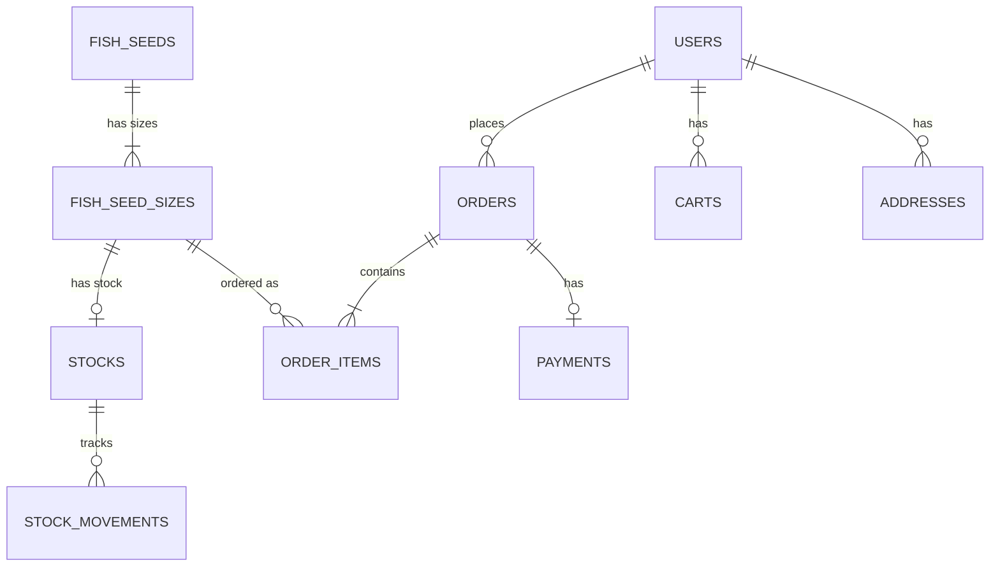

<p align="center">
  <h1 align="center">🐟 Sistem Penjualan Budidaya Bibit Ikan</h1>
  <p align="center">
    <strong>Platform E-Commerce Budidaya Bibit Ikan berbasis Laravel 12 dengan Integrasi Google SSO & Midtrans Payment Gateway</strong>
  </p>
</p>

<p align="center">
  
  
  
  
  
  
</p>

---

## 📌 Tentang Proyek

Sistem ini adalah aplikasi web penjualan (e-commerce) hasil budidaya bibit ikan air tawar. Dirancang untuk menggantikan proses pencatatan konvensional menjadi terintegrasi secara digital, mulai dari katalog bibit ikan multi-ukuran, inventori stok real-time, perhitungan estimasi ongkos kirim, hingga pembayaran otomatis menggunakan QRIS / Virtual Account.

Sistem ini menerapkan standar keamanan modern dengan protokol **Single Sign-On (SSO) Google OAuth 2.0 / OpenID Connect** untuk memudahkan pelanggan bertransaksi tanpa harus membuat password baru.

---

## ✨ Fitur Utama

### 🛒 Pelanggan (Customer)
* **Autentikasi SSO Google:** Login dan pendaftaran instan menggunakan akun Google via OAuth 2.0.
* **Katalog Bibit Interaktif:** Jelajahi berbagai jenis bibit ikan (Nila, Lele, Gurame, Patin, Mas, Bawal) beserta deskripsi lengkap dan foto produk.
* **Varian Ukuran & Harga Dinamis:** Setiap jenis bibit memiliki opsi ukuran (misal: 2-3 cm, 3-5 cm, 5-7 cm) dengan harga dan stok masing-masing.
* **Keranjang Belanja (Cart):** Pengelolaan item keranjang, penyesuaian kuantitas, dan validasi ketersediaan stok.
* **Checkout & Cek Ongkos Kirim:** Terintegrasi dengan API data wilayah (Provinsi & Kabupaten/Kota) dan estimasi ongkos kirim.
* **Pembayaran Digital Otomatis:** Pembayaran via Midtrans Snap (QRIS, GoPay, ShopeePay, Virtual Account Bank) dengan verifikasi otomatis via webhook.
* **Dashboard Pesanan:** Memantau riwayat transaksi, status pembayaran, status pengiriman, serta nomor resi kurir.

### ⚙️ Administrator (Pemilik Usaha)
* **Dashboard Analitik:** Statistik ringkasan pesanan masuk, total pendapatan, grafik performa penjualan, dan peringatan stok menipis (*low-stock alert*).
* **Manajemen Bibit Ikan (`FishSeed`):** CRUD data master ikan, kategori, deskripsi, dan upload foto.
* **Manajemen Varian Ukuran (`FishSeedSize`):** Pengaturan ukuran bibit ikan serta harga spesifik per ukuran.
* **Manajemen Stok & Riwayat Mutasi (`Stock` & `StockMovement`):** Kontrol stok masuk/keluar, histori pergerakan stok, dan otomatisasi pengurangan stok saat transaksi berhasil.
* **Manajemen Pesanan (`Orders`):** Verifikasi pesanan, update status proses (Diproses, Dikemas, Dikirim, Selesai), dan input nomor resi pengiriman.
* **Laporan Penjualan & Stok (`Reports`):** Filter laporan berdasarkan periode tanggal, ringkasan produk terlaris, dan rekapitulasi mutasi stok.

---

## 🛠️ Tech Stack & Integrasi

* **Backend:** [Laravel 12](https://laravel.com/) (PHP >= 8.2)
* **Database:** MySQL
* **Frontend:** Blade Templating, [Tailwind CSS v4](https://tailwindcss.com/), [DaisyUI v5](https://daisyui.com/), [Vite](https://vitejs.dev/)
* **Autentikasi:** [Laravel Socialite](https://laravel.com/docs/socialite) (Google OAuth 2.0 / OpenID Connect)
* **Payment Gateway:** [Midtrans PHP SDK](https://github.com/Midtrans/midtrans-php) (Snap API & Webhook Handler)
* **Layanan Ongkir:** BinderByte API / RajaOngkir API

---

## 🗄️ Struktur Entitas Database Utama



---

## 🚀 Panduan Instalasi & Setup Lokal

Ikuti langkah-langkah berikut untuk menjalankan proyek di komputer lokal:

### 1. Prasyarat Sistem
* PHP >= 8.2 (ekstensi: `pdo_mysql`, `curl`, `mbstring`, `openssl`, `gd`, `zip`)
* Composer >= 2.x
* Node.js (v18+) & NPM
* Web Server (Apache/Nginx via XAMPP/Laragon)
* MySQL Database

### 2. Clone Repositori
```bash
git clone https://github.com/hidayaturromadhan/NAMA-REPO-ANDA.git
cd budidaya-bibit
```

### 3. Install Dependensi (PHP & Node.js)
```bash
composer install
npm install
```

### 4. Konfigurasi Environment (`.env`)
Salin file `.env.example` menjadi `.env`:
```bash
cp .env.example .env
```
Buka file `.env` dan sesuaikan konfigurasi database serta kredensial API:

```env
APP_NAME="Budidaya Bibit Ikan"
APP_URL=http://localhost:8000

DB_CONNECTION=mysql
DB_HOST=127.0.0.1
DB_PORT=3306
DB_DATABASE=budidaya_bibit
DB_USERNAME=root
DB_PASSWORD=

# Google OAuth (SSO)
GOOGLE_CLIENT_ID=your_google_client_id
GOOGLE_CLIENT_SECRET=your_google_client_secret
GOOGLE_REDIRECT_URI="${APP_URL}/auth/google/callback"

# Midtrans Payment Gateway
MIDTRANS_MERCHANT_ID=your_merchant_id
MIDTRANS_CLIENT_KEY=your_client_key
MIDTRANS_SERVER_KEY=your_server_key
MIDTRANS_IS_PRODUCTION=false

# Layanan Cek Ongkir (BinderByte)
BINDERBYTE_API_KEY=your_binderbyte_api_key
BINDERBYTE_ORIGIN_CITY="31.74"
```

### 5. Generate Key & Link Storage
```bash
php artisan key:generate
php artisan storage:link
```

### 6. Migrasi & Seeder Database
Jalankan migrasi database beserta data dummy awal:
```bash
php artisan migrate --seed
```

### 7. Jalankan Server Aplikasi
Jalankan aplikasi beserta bundler Vite:
```bash
# Terminal 1: Backend Laravel
php artisan serve

# Terminal 2: Vite Assets
npm run dev
```
Atau cukup gunakan satu perintah runner:
```bash
composer run dev
```

Akses sistem di browser melalui: **`http://localhost:8000`**

---

## 🔑 Akun Uji Coba Default

Setelah menjalankan `php artisan migrate --seed`, akun berikut siap digunakan:

| Peran (Role) | Email | Password | Hak Akses |
|---|---|---|---|
| **Administrator** | `admin@admin.com` | `password` | Akses penuh Panel Admin (`/admin/dashboard`) |
| **Pelanggan** | `user@user.com` | `password` | Belanja, Checkout, Dashboard Pelanggan (`/dashboard`) |
| **Pelanggan (SSO)** | *Akun Google Pribadi* | *-* | Login instan dengan tombol **"Login with Google"** |

---

## 🧪 Pengujian Otomatis (Testing)

Untuk menjalankan seluruh rangkaian automated feature & unit tests:
```bash
php artisan test
```

---

## 📁 Struktur Direktori Penting

```text
budidaya-bibit/
├── app/
│   ├── Http/Controllers/
│   │   ├── Admin/           # Controller modul Admin (Bibit, Stok, Pesanan, Laporan)
│   │   ├── AuthController.php          # Login manual & callback SSO Google
│   │   ├── CartController.php          # Logika keranjang belanja
│   │   ├── CheckoutController.php      # Checkout & inisialisasi Midtrans Snap
│   │   ├── MidtransWebhookController.php # Webhook listener Midtrans
│   │   └── OngkirController.php        # Integrasi wilayah & cek ongkir
│   └── Models/              # Model Eloquent (FishSeed, Stock, Order, Payment, dll)
├── database/
│   ├── migrations/          # Definisi skema tabel database
│   └── seeders/             # Data awal bibit ikan, ukuran, stok, & akun demo
├── resources/
│   └── views/               # Blade templates UI (katalog, cart, checkout, dashboard)
├── routes/
│   └── web.php              # Rute aplikasi & proteksi middleware role
└── tests/                   # Automated feature & unit tests
```

---

## 📄 Lisensi

Proyek ini dilisensikan di bawah lisensi [MIT License](LICENSE).
